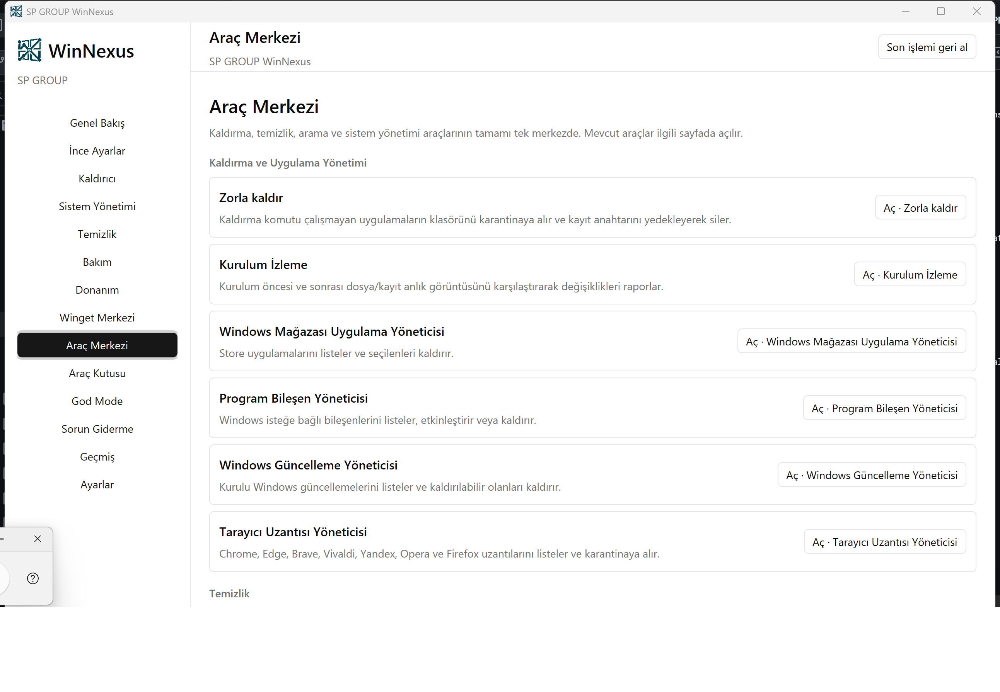
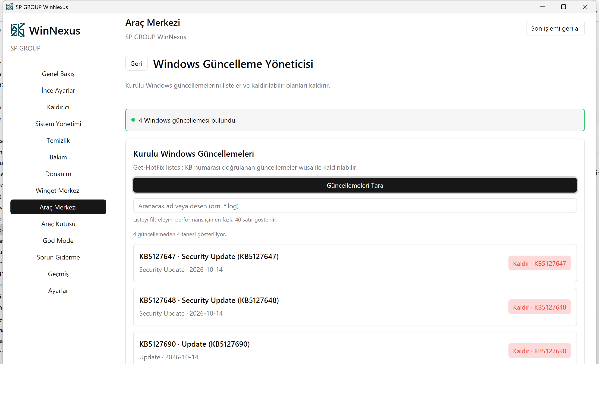
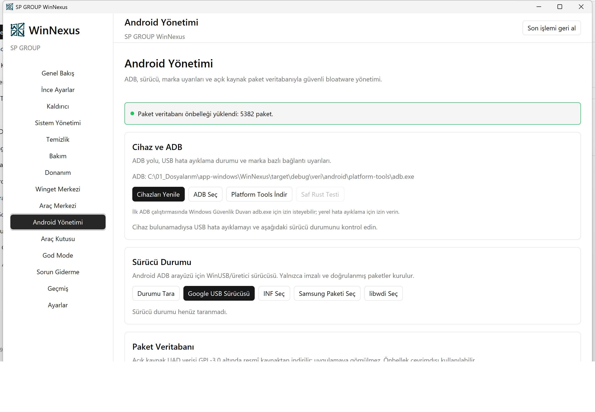
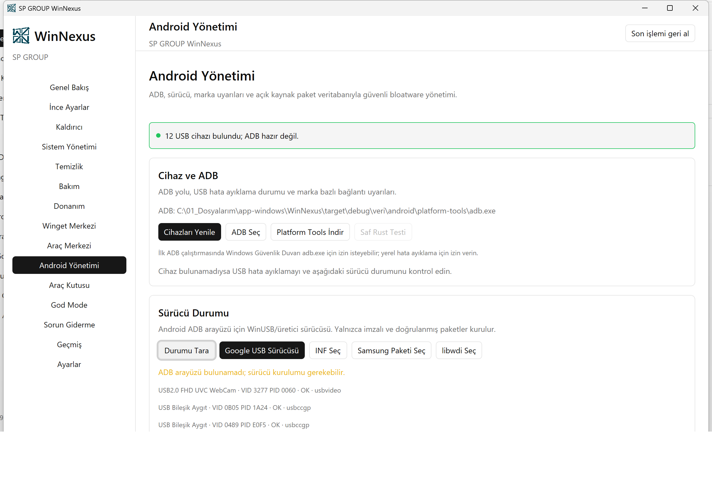
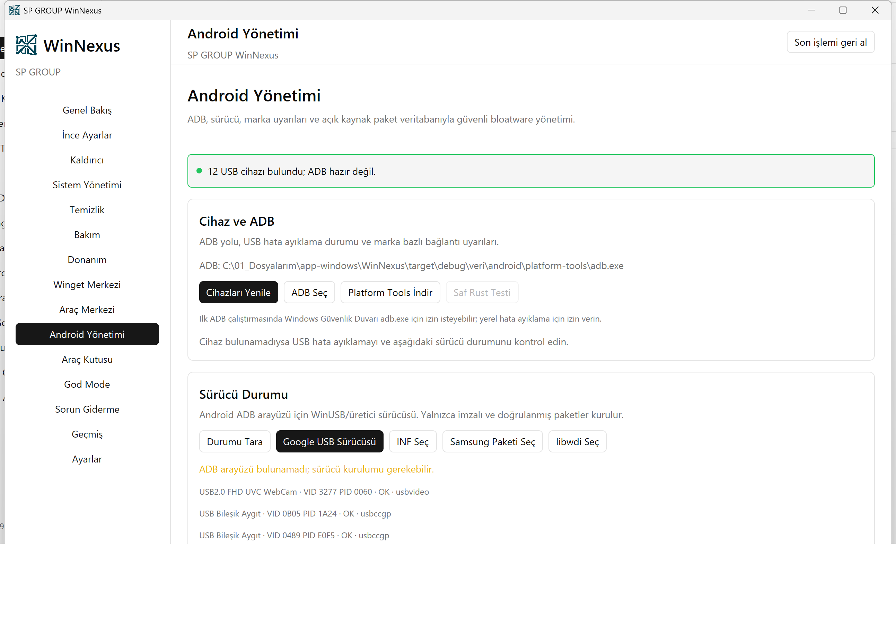
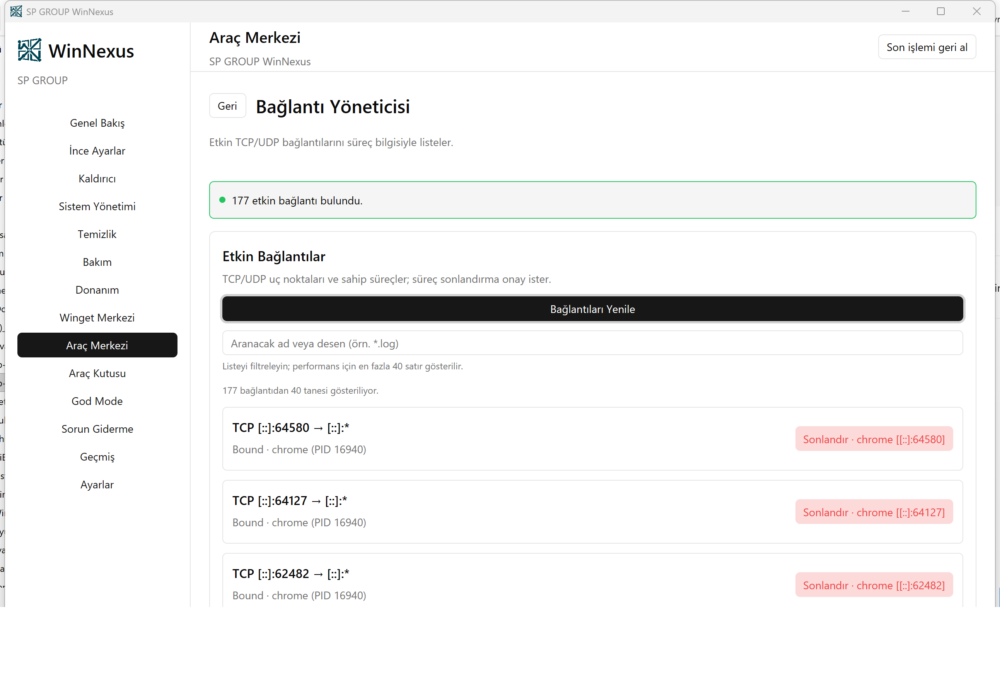
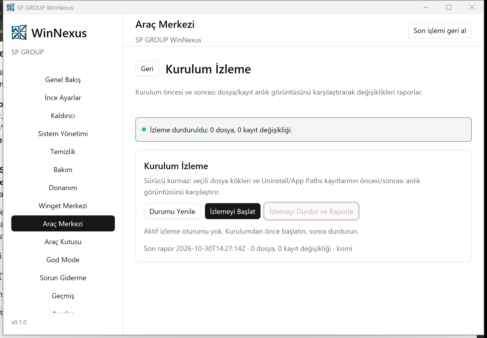
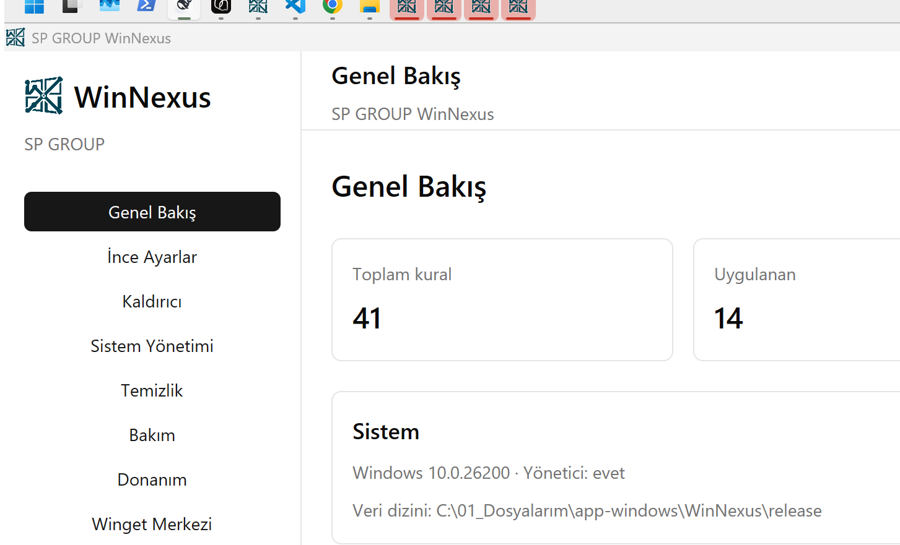

<p align="center">
  
  <br>
  <strong>SP GROUP WinNexus</strong>
</p>

# SP GROUP WinNexus

Rust ve GPUI Kit ile geliştirilen; Windows bakımı, ince ayar, uygulama yönetimi ve günlük sistem araçlarını tek, güvenli ve geri alınabilir bir masaüstü arayüzünde birleştiren uygulama.

## Özellikler

- GPU hızlandırmalı GPUI Kit arayüzü; açık/koyu tema, tam Türkçe imlâ ve klavye-first gezinme
- 41 yerleşik ince ayar: gizlilik, görev çubuğu, Explorer, tema, öneriler, telemetri, uzun dosya yolları, açılışta Num Lock ve daha fazlası
- Tek mutasyon kuyruğu; önizleme, risk onayı, günlük ve otomatik geri alma
- **Kaldırıcı:** Kayıt defterindeki kurulu masaüstü uygulamalarını listeler; arama, sessiz/interaktif kaldırma, isteğe bağlı sistem geri yükleme noktası, artık dosya/registry taraması, karantina ve işlem geçmişi sunar. Tekil modda her uygulama için Kaldır/Sessiz Kaldır/Artıklar; toplu modda kutucuklarla seçip toplu kaldırma ve otomatik artık karantinası
- **Sistem Yönetimi:** Başlangıç öğeleri (yedekli devre dışı bırakma), servisler, zamanlanmış görevler ve süreçler; onaylı başlat/durdur/sonlandır işlemleri
- **Temizlik:** İzinli geçici ve tarayıcı önbellekleri, boş klasörler, yinelenen dosyalar, 3 geçişli dosya parçalayıcı ve geri dönüşüm kutusu; ayrıca simge/küçük resim önbelleği, son kullanılanlar, WER, Windows günlükleri, Windows Update indirmeleri, Teslimat İyileştirme, Defender geçmişi, geliştirici önbellekleri, Visual Studio kaynağı, Chrome kurulum önbelleği, INetCache, eski Chrome sürümleri, kayıt defteri temizleyici ve bozuk kısayol temizleyici. Kopyalar ve registry kayıtları karantinaya alınır
- **Araç Merkezi:** 21 aracın tamamı tek merkezde: Zorla kaldır, Kurulum İzleme (dosya/kayıt anlık görüntüsü), Windows Mağazası/Program Bileşen/Windows Güncelleme yöneticileri, Tarayıcı Uzantısı Yöneticisi, Kayıt Defteri/Gereksiz Dosya/Boş Klasör/Kısayol temizleyicileri, Dosya ve Kayıt Bulucu, Kopya Dosya Bulucu, Disk Analisti, dosyaları kalıcı silme, İşlem/Bağlantı/Başlangıç/Hizmet/Zamanlanmış Görev/Sağtık Menü/Sistem Geri Yükleme yöneticileri. Mevcut araçlar ilgili sayfaya yönlendirilir; yeni araçlar Araç Merkezi sayfasında çalışır. Yıkıcı işlemler onay ister; dosyalar karantinaya, registry kayıtları `.reg` yedeğine alınır.
- **Bakım:** DISM bileşen deposu analizi/temizliği/sağlık taraması/onarımı ve ResetBase, SFC, Appx listesi/onarımı, Windows özellikleri, sürücü dışa aktarma, Windows Update geçmişi görüntüleme/temizleme, geri yükleme noktaları (oluşturma, geri dönme, sistem korumasını açma/kapatma, en yenisi korunarak temizleme), simge önbelleği onarımı ve Windows sorun gidericileri; Microsoft/Windows sistem paketleri korunur
- **Donanım:** Sistem özeti, CPU/GPU/RAM, fiziksel disk sağlığı, WLAN profilleri, UAC ve Uzak Masaüstü durumu; salt okunur
- **Store Uygulamaları:** Appx envanteri; yalnızca üçüncü taraf paketler onayla kaldırılabilir
- **Winget Merkezi:** Kaynak listeleme/ekleme/kaldırma, mağaza araması, önerilen profillerden ve arama sonuçlarından kutucuklu seçim, kurulu paket taraması, seçili güncelleme/kaldırma, liste içe/dışa aktarma, 4 hazır profil, blocking pin, sürüm sabitleme (gating), “bu sefer” atlama, pin kaldırma, eksik/benzer paket önerisi, sözleşme onayları ve komut günlüğü
- **Araç Kutusu:** Bu Bilgisayar klasörleri, Hızlı Erişim, Fotoğraf Görüntüleyici, Explorer/BIOS komutları, “Sahipliği Al” sağ tık menüsü, bağlam menüsü yöneticisi (Blocked listesiyle geri alınabilir), klasik sağ tık menüsü
- **God Mode:** Windows denetim masası görevlerinin tamamını masaüstünde klasör oluşturmadan, Explorer’ın `shell:::{ED7BA470-8E54-465E-825C-99712043E01C}` protokolüyle ayrı pencerede açar
- **Yasal uyarı kapısı:** İlk açılışta “Yasal Uyarı ve Sorumluluk Reddi” metni gösterilir; kullanıcı açıkça kabul etmeden uygulama kullanılamaz. Kabul durumu `settings.toml` içinde saklanır.
- **Android Yönetimi:** Gömülü/indirilen Platform Tools, sistem ADB’si ve saf Rust `adb_client` arka uçları; cihaz/marka/Android sürümü algılama; Xiaomi/HyperOS, Oppo/Realme/OnePlus ve Samsung Auto Blocker uyarıları; imzalı Google WinUSB, Samsung ve yerel INF sürücü kurulumu; isteğe bağlı libwdi; UAD-ng paket veritabanını (GPL-3.0) resmî kaynaktan indirme/önbelleğe alma veya JSON içe aktarma; 5.000+ paket için risk, bağımlılık ve açıklama; kullanıcı 0 kaldırma, devre dışı bırakma, etkinleştirme, `install-existing` ile geri yükleme ve güvenli toplu işlemler
- **Sorun Giderme:** npm global prefix/PATH ve global paketler, PowerShell execution policy (CurrentUser/LocalMachine), MMAgent bellek sıkıştırma; GPO uyarısı, durum denetimi ve onaylı düzeltme
- **Taşınabilir çalışma:** Ayarlar ve tüm veriler exe’nin yanındaki `settings.toml` ve `veri/` altında tutulur; pencere açılışta tam ekran (maximize) açılır
- Erişilebilir durum rozetleri, görünür odak halkaları, 24×24 asgari hedefler ve Windows animasyon ayarına saygılı hareket
- Yerel çalışma; telemetri, bulut eşitleme ve arka plan ağ isteği yok

## Klavye

| Kısayol | Eylem |
| --- | --- |
| Tab / Shift+Tab | Odaklanabilir öğeler arasında ilerle / geri dön |
| Enter / Boşluk | Odaklı düğmeyi çalıştır |
| Fare tekerleği | Listelerde ve sayfa içeriğinde kaydır |

Tüm düğmeler GPUI Kit'in odak sistemiyle klavyeden kullanılabilir; onay panelleri “Vazgeç” düğmesiyle kapatılır. Ekran okuyucular için AccessKit semantiği ve erişilebilir adlar sağlanır.

## Hazır Uygulama

`release` klasöründeki `WinNexus_beta-vYYYYMMDDHHMM.exe` dosyası kurulum gerektirmez ve doğrudan çalıştırılır. Klasörde yalnızca en güncel sürüm bulundurulur; her release derlemesinde önceki sürümler otomatik olarak kaldırılır. Dosya adındaki `vYYYYMMDDHHMM` damgası derleme anını gösterir ve uygulama içindeki sürüm etiketiyle aynıdır.

Release derlemesi `requireAdministrator` manifesti içerir; ilk açılışta Windows UAC onayı istenir. Geliştirme derlemesi bu manifesti içermez.

## Kaynaktan Derleme

Gereksinimler:

- Rust (MSVC hedefi)
- Visual Studio 2022 Build Tools — Desktop development with C++
- Windows SDK

```powershell
# Geliştirme derlemesi ve çalıştırma
powershell -NoProfile -ExecutionPolicy Bypass -File scripts/build.ps1 "run -p sp-app"

# Release derlemesi, yönetici manifesti ve portatif exe
powershell -NoProfile -ExecutionPolicy Bypass -File scripts/release.ps1
```

`scripts/release.ps1`; release derlemesini yapar, `mt.exe` ile `requireAdministrator` manifestini uygular, sürüm/ikon kaynaklarını doğrular ve güncel exe'yi `release` klasörüne tarih damgalı olarak kopyalar. Derleme betiği Git Bash'teki `link.exe` çakışmasını önlemek için MSVC ortamını (`vcvars64.bat`) yükler.

## Geliştirici Kurulumu (Yeni Bilgisayar)

```powershell
cd WinNexus
powershell -NoProfile -ExecutionPolicy Bypass -File scripts/build.ps1 "test"
powershell -NoProfile -ExecutionPolicy Bypass -File scripts/build.ps1 "build -p sp-app"
```

GPUI Kit ve diğer Rust bağımlılıkları Cargo tarafından indirilir. Cargo derleme önbelleği (`target/`) makineye ve yola özgüdür; depoya dahil edilmez ve kopyalanamaz. `release` klasörü yalnızca dağıtılabilir çıktıyı taşır.

## Mimari

- Arayüz GPUI Kit 0.8.1 üzerinde çalışır (`gpui-pre 0.3.10`, `gpui-component 0.8.1`, Apache-2.0).
- `sp-app` arayüzü ve sayfaları; `sp-core` domain, kural motoru, günlük, kaldırıcı, sistem yönetimi, temizlik, bakım, onarım, Araç Merkezi, donanım, artık ve Winget/Android modellerini; `sp-win` aynı alanların Windows adaptörlerini taşır.
- Kaldırıcı, HKLM/HKCU 32/64 bit Uninstall anahtarlarını tarar; sistem bileşenlerini ve güncellemeleri listeden çıkarır. Kaldırma komutu onay panelinde gösterilir; MSI kayıtları için `/qn /norestart` sessiz komutu üretilir. İsteğe bağlı geri yükleme noktası `Checkpoint-Computer` ile oluşturulur. Artık taraması yalnızca kurulum konumu ve tam ad eşleşmelerini kullanır; dosyalar karantinaya taşınır, registry anahtarları `reg export` ile yedeklenir.
- Başlangıç öğeleri HKCU/HKLM Run, RunOnce ve başlangıç klasörlerinden okunur; devre dışı bırakılanlar JSON yedeği ve dosya taşıma ile geri alınabilir. Servis/görev/süreç işlemleri sabit `sc.exe`, `powershell` ve `taskkill` şablonlarıyla, ad/pid doğrulamasıyla çalışır.
- Temizlik yalnızca izinli `%TEMP%`, `Windows\Temp` ve bilinen tarayıcı önbellek köklerinde çalışır; sembolik bağlantılar izlenmez. Gelişmiş kategoriler sabit sistem yollarında, yeniden ayrıştırma noktalarını atlayarak çalışır; Windows Update indirmeleri hizmetler durdurulup yeniden başlatılarak temizlenir. Yinelenen dosyalar boyut + hash + bayt doğrulamasıyla bulunur ve karantinaya taşınır. Parçalayıcı 3 geçişlidir; SSD’lerde fiziksel silme garantisi vermez.
- Bakım komutları DISM, SFC, PowerShell ve `pnputil` üzerinden sabit argümanlarla çalışır. Appx/Store listelerinde Microsoft/Windows sistem paketleri kaldırma dışında tutulur; Appx onarımı paketi yeniden kaydeder. Windows Update geçmişi `Get-HotFix` ile okunur, temizlik yalnızca onayla ve hizmetler durdurularak yapılır. Eski geri yükleme noktaları silinirken en yeni nokta korunur. Donanım bilgileri CIM/registry ile çekirdek sürücüsü olmadan okunur; UAC/RDP salt okunurdur.
- Araç Merkezi: kayıt defteri temizleyici doğrulanabilir eksik kaldırma yollarını, uygulama yollarını, paylaşılan DLL’leri, yazı tipi/ses/MUI/yardım kayıtlarını işaretler; her anahtar veya değer `reg export` ile yedeklenmeden silinmez. Bozuk kısayollar silinmez, karantinaya taşınır ve manifest ile izlenir. Bağlam menüsü uzantıları HKCU `Shell Extensions\Blocked` listesiyle geri alınabilir şekilde kapatılır; klasik menü anahtarı yalnızca ilgili CLSID altında değiştirilir. Windows Güncelleme Yöneticisi `Get-HotFix` listesini gösterir ve doğrulanmış KB numaralarını `wusa /uninstall` ile kaldırır. Tarayıcı Uzantısı Yöneticisi Chromium profillerini ve Firefox `extensions.json` kayıtlarını okur; kaldırma klasörü karantinaya taşır. Bağlantı Yöneticisi `Get-NetTCPConnection`/`Get-NetUDPEndpoint` ile süreç eşlemeli TCP/UDP listesi verir. Dosya ve Kayıt Bulucu joker destekli dosya araması ve sınırlı registry araması yapar; Disk Analisti kök boyutlarını ve en büyük dosyaları çıkarır. Kurulum İzleme sürücü kurmadan Program Files/ProgramData/AppData ve Uninstall/App Paths anlık görüntüsünü karşılaştırır. Zorla Kaldırma kurulum klasörünü karantinaya taşır ve Uninstall kaydını `.reg` yedeğiyle siler. Sistem Geri Yükleme Yöneticisi nokta oluşturma, geri dönme ve korumayı açma/kapatma işlemlerini yönetici onayıyla yürütür.
- Araç Merkezi listeleri en fazla 40 etkileşimli satır gösterir; arama kutusuyla daraltılır. GPUI 0.8.1’in çok sayıda etkileşimli öğe içeren listelerdeki kararsızlığını önlemek için her satırda tek düğme ve benzersiz öğe kimliği kullanılır.
- Komut çıktıları önce UTF-8, ardından Windows OEM kod sayfası (`MultiByteToWideChar(CP_OEMCP)`) ile çözülür; Türkçe PowerShell hataları bozulmadan ve yığın izi gösterilmeden raporlanır.
- İnce ayarlar TOML kural paketlerindedir. Her kural algılama, uygulama ve doğrulama adımlarına sahiptir; registry değişiklikleri işlem öncesi değerle günlüğe yazılır ve otomatik olarak geri alınabilir.
- Tüm sistem mutasyonları tek bir iş kuyruğundan geçer. Toplu işlemlerde adım sırası, risk denetimi ve hata durumunda işlem içi ters sıralı geri alma uygulanır.
- Winget işlemleri sabit argüman şablonlarıyla, paket bazında yürütülür; `upgrade --all` kullanılmaz. Kaynak adları/adresleri, paket kimlikleri ve liste dosyaları doğrulanır; kaynak adresi yalnızca `https://` olabilir. Mağaza, kurulu paketler ve liste içe/dışa aktarma aynı komut geçmişini kullanır.
- Toplu kaldırma modu, kaldırılan her uygulamanın artıklarını otomatik tarar ve karantinaya taşır; tekil modda her uygulama için ayrı Artıklar taraması korunur. Çok sayıda düğme/odak öğesi içeren listeler mod ayrımıyla sınırlandırılır.
- Android paket kimliği ve cihaz serisi doğrulanır; komutlar argüman dizisiyle çalışır, kabuk enjeksiyonu yapılmaz. Güvensiz paketler kaldırılamaz; uzman/bilinmeyen riskler açık onay ister.
- “Sahipliği Al” sağ tık menüsü, uygulamanın gizli `--sahipligi-al <yol>` modunu çağırır; `takeown` ve `icacls` argüman dizisiyle çalışır.
- Tercihler doğrudan exe’nin yanındaki `settings.toml` dosyasına, günlükler/karantina/geçici veriler exe yanındaki `veri/` klasörüne yazılır. Böylece uygulama klasörü taşındığında ayarlar da taşınır; eski `%APPDATA%` ayarı ilk açılışta bir kez devralınır. Yeni `%APPDATA%`/`%LOCALAPPDATA%` verisi oluşturulmaz.

## Güvenlik

- Uygulama yalnızca yerel dosya ve sistem kaynaklarını işler; arka planda ağ isteği yapmaz, kullanıcı verisi toplamaz.
- Ağ yalnızca kullanıcının açıkça başlattığı Winget, Platform Tools, Android sürücüsü ve UAD veritabanı işlemlerinde kullanılır.
- Release derlemesi yönetici izni ister; tehlikeli işlemler öncesi onay paneli ve işlem günlüğü uygulanır.
- Winget lisans ve kaynak sözleşmeleri varsayılan olarak kapalıdır; açılmadan toplu işlem başlatılmaz.
- Serbest komut girişi yoktur; kaldırma komutları yalnızca kayıt defterindeki Uninstall kayıtlarından gelir, tam komut onay panelinde gösterilir ve kontrol karakterleri reddedilir.
- Android kaldırma yalnızca kullanıcı 0 içindir; `install-existing` ile geri yüklenir. Sürücüler yalnızca geçerli Authenticode imzasıyla kurulur.
- Registry değişiklikleri işlem öncesi değerle günlüğe yazılır; hata durumunda otomatik geri alma uygulanır.
- Başlangıç öğeleri devre dışı bırakılmadan önce JSON yedeğine alınır; başlangıç klasörü dosyaları yedek dizinine taşınır. Kaldırıcı artıkları kalıcı silinmez, karantinaya taşınır; registry anahtarları `.reg` olarak dışa aktarılmadan silinmez.
- Temizlik hedefleri izinli köklerle sınırlıdır; kök dizin, sembolik bağlantı ve izin dışı yollar reddedilir. Yinelenen dosyalarda ilk kopya korunur, yalnızca ek kopyalar karantinaya alınır.
- Microsoft/Windows Appx ve Store paketleri sistem paketi olarak işaretlenir ve arayüzden kaldırılamaz. Windows özellikleri, DISM temizliği ve onarımı yönetici onayı ister.
- Komut hatalarında ham PowerShell yığın izleri kullanıcıya gösterilmez; yalnızca özlü Türkçe hata ve gerekli durumda yönetici izni mesajı verilir.
- npm PATH düzeltmesi kullanıcı kapsamında (HKCU) yapılır; makine PATH'i varsayılan olarak değiştirilmez. Execution policy için CurrentUser önerilir, GPO ayarları ezilmez. MMAgent değişiklikleri yönetici izni ister ve yeniden başlatma önerilir.

## Doğrulama

```powershell
powershell -NoProfile -ExecutionPolicy Bypass -File scripts/build.ps1 "fmt --all"
powershell -NoProfile -ExecutionPolicy Bypass -File scripts/build.ps1 "clippy --workspace --all-targets -- -D warnings"
powershell -NoProfile -ExecutionPolicy Bypass -File scripts/build.ps1 "test"
powershell -NoProfile -ExecutionPolicy Bypass -File scripts/release.ps1
powershell -NoProfile -ExecutionPolicy Bypass -File scripts/ui-yeni.ps1
powershell -NoProfile -ExecutionPolicy Bypass -File scripts/ui-android.ps1
powershell -NoProfile -ExecutionPolicy Bypass -File scripts/ui-arac-merkezi.ps1
powershell -NoProfile -ExecutionPolicy Bypass -File scripts/ui-arac-merkezi-taramalar.ps1
powershell -NoProfile -ExecutionPolicy Bypass -File scripts/ui-kaldirici-toplu.ps1
```

338 birim testi; kural sözleşmesi, registry sandbox, iş motoru, geri alma, Winget ayrıştırma/kaynak/mağaza/liste/politika, ADB komutları, sahiplik, kaldırma/geri yükleme güvenliği, toplu kaldırma ve artık karantinası, başlangıç yedeği, servis/görev/süreç ayrıştırma, temizlik/karantina/parçalama, gelişmiş temizlik/onarım/geri yükleme noktaları, kayıt defteri/kısayol/bağlam menüsü/güncelleme/uzantı/bağlantı/bulucu/disk analizi/kurulum izleme/zorla kaldırma, DISM/Appx/sürücü, donanım JSON/OEM kodlama ve sorun giderme mantığını kapsar. Arayüz doğrulaması; 15 sayfa, uygula/geri al, tarama, sekmeler, toplu seçim ve onay panelleri ekran görüntüleriyle yapılır. Araç Merkezi sayfası 21 aracın tamamını listeler; Android Yönetimi sayfası sürücü taraması, UAD önbelleği ve ADB akışıyla UIA üzerinden doğrulanır.

## Ekran Görüntüleri

<p align="center">
  
  
</p>
<p align="center">
  
  
</p>
<p align="center">
  
</p>
<p align="center">
  
  
</p>
<p align="center">
  
</p>

## Depo Yapısı

| Dizin | İçerik |
| --- | --- |
| `crates/sp-app/` | GPUI arayüzü, 15 sayfa, tema ve uygulama ikonu bağlantısı |
| `crates/sp-core/` | Domain, kural motoru, günlük, kaldırıcı, sistem yönetimi, temizlik, bakım, onarım, Araç Merkezi, donanım, artık ve Winget/Android modelleri |
| `crates/sp-win/` | Registry, kaldırıcı, sistem yönetimi, temizlik, bakım, onarım, Araç Merkezi, donanım, artık, Winget, Android ve sahiplik adaptörleri |
| `rules/tweaks/` | 41 TOML ince ayar kuralı |
| `profiles/` | Winget paket profilleri |
| `assets/` | Uygulama ikonu (PNG/ICO) |
| `docs/` | Tasarım, plan ve teknik kanıt notları |
| `scripts/` | Derleme, release ve UI doğrulama betikleri |
| `tests/` | Doğrulama ekran görüntüleri |
| `release/` | Güncel portatif uygulama çalıştırıcısı |

## Yasal Uyarı ve Sorumluluk Reddi

> Bu metin uygulamanın ilk açılışında gösterilir; kullanıcı açıkça kabul etmeden uygulama kullanılamaz. Metnin uygulama içinde gösterilen tam sürümü `docs/yasal-uyari.txt` dosyasındadır.

Bu yazılım ve içerdiği tüm modüller, SP GROUP ENERJİ SAN. VE TİC. LTD. ŞTİ. tarafından "olduğu gibi" ve "mevcut haliyle" sunulmaktadır. Uygulamayı indiren, kuran, çalıştıran veya kullanan herkes bu uyarıyı okuduğunu, anladığını ve kabul ettiğini beyan eder.

**1. Kullanım sorumluluğu.** Kullanıcı; uygulama üzerinden gerçekleştirilecek kaldırma, silme, temizleme, onarım, servis/görev değiştirme, sürücü/özellik yönetimi, registry düzenleme, Winget işlemleri ve benzeri tüm işlemlerden önce gerekli yedekleri almak, sistem geri yükleme noktası oluşturmak ve işlemleri uygun bir test ortamında doğrulamakla yükümlüdür. Veri kaybı, dosya bozulması, işletim sistemi veya donanım hasarı, iş kesintisi, kâr kaybı ve üçüncü taraf zararları dahil olmak üzere uygulamanın kullanımından doğan tüm risk ve sonuçlar kullanıcıya aittir.

**2. Garanti reddi.** Uygulama, açık veya zımni hiçbir garanti verilmeksizin sunulur. Satılabilirlik, belirli bir amaca uygunluk, hatasızlık, kesintisiz çalışma, doğruluk, güncellik, güvenlik ve virüsten arındırılmış olma dahil ancak bunlarla sınırlı olmamak üzere her türlü garanti reddedilir. Uygulamanın kullanımından elde edilecek sonuçların doğruluğu veya güvenilirliği garanti edilmez.

**3. Sorumluluğun sınırlandırılması.** Yürürlükteki zorunlu hukuk kurallarının izin verdiği azami ölçüde; SP GROUP ENERJİ SAN. VE TİC. LTD. ŞTİ., geliştiricileri, lisans verenleri ve tedarikçileri; doğrudan, dolaylı, özel, cezai, örnek niteliğinde veya sonuç olarak ortaya çıkan zararlardan, veri kaybından, kâr kaybından, iş kaybından, itibar kaybından, donanım veya yazılım hasarından, üçüncü taraf taleplerinden ve her türlü giderden sorumlu tutulamaz. Bu sınırlama, zararın öngörülebilir olup olmadığına bakılmaksızın uygulanır.

**4. Geri alınamaz işlemler.** Uygulamadaki bazı işlemler geri alınamaz veya tamamen geri döndürülemez. Özellikle dosya silme, karantinaya taşıma, geri dönüşüm kutusunu boşaltma, dosya parçalama, uygulama kaldırma, Appx/Store paketi kaldırma, DISM ResetBase, SFC/DISM onarımı, Windows Update veri deposu temizliği, eski geri yükleme noktalarının silinmesi, servis/görev yapılandırması, sürücü/özellik değişiklikleri ve registry temizliği bu kapsamdadır. Kullanıcı bu işlemleri onaylamadan önce riskleri değerlendirmekle yükümlüdür.

**5. Yönetici yetkisi ve hukuki uygunluk.** Kullanıcı, uygulamayı kullanabilmek için gerekli yönetici haklarına ve ilgili sistem, cihaz, hesap ve veriler üzerinde işlem yapma yetkisine sahip olduğunu kabul eder. Uygulamanın kullanımı, kullanıcının tabi olduğu mevzuata, kurum politikalarına ve üçüncü taraf lisans koşullarına aykırı olamaz. Kullanıcı, bu kurallara uymaktan tek başına sorumludur.

**6. Üçüncü taraf bileşenler.** Uygulama; Microsoft Windows, Explorer, PowerShell, DISM, SFC, Winget, ADB ve benzeri üçüncü taraf bileşen ve hizmetlerle birlikte çalışabilir. Bu bileşenler kendi lisans ve kullanım koşullarına tabidir. SP GROUP ENERJİ SAN. VE TİC. LTD. ŞTİ., Microsoft Corporation veya diğer üçüncü taraflarla bağlantılı değildir; bu bileşenlerin davranışı, kullanılabilirliği, güvenliği veya sonuçlarından sorumlu değildir.

**7. Tazminat.** Kullanıcı; uygulamanın hukuka aykırı, yetkisiz veya bu uyarıya aykırı kullanımından doğan üçüncü taraf talepleri, zararları, kayıpları ve masrafları (makul avukatlık ücretleri dahil) yürürlükteki hukukun izin verdiği ölçüde tazmin etmeyi kabul eder.

**8. Yürürlük ve bölünebilirlik.** Bu uyarı, uygulamanın ilk çalıştırılmasında kullanıcıya gösterilir ve kullanıcı tarafından kabul edilmedikçe uygulama kullanılamaz. Bu metnin herhangi bir hükmünün geçersiz veya uygulanamaz sayılması, diğer hükümlerin yürürlüğünü etkilemez. Yürürlükteki zorunlu tüketici, sorumluluk ve kamu düzeni hükümleri her durumda saklıdır. SP GROUP ENERJİ SAN. VE TİC. LTD. ŞTİ., bu metni mevzuat ve ürün gelişmeleri doğrultusunda güncelleme hakkını saklı tutar.

**Kabul beyanı:** "Yasal Uyarı ve Sorumluluk Reddi" metnini okudum, anladım ve kabul ediyorum. Uygulamayı kendi sorumluluğumda kullanacağımı, işlem öncesinde yedek alacağımı ve geri alınamaz işlemlerin sonuçlarını üstleneceğimi beyan ederim.

## Lisans

- Uygulama kodu Apache-2.0 lisansıyla dağıtılır.
- GPUI Kit paketleri (`gpui-kit`, `gpui-component`, `gpui-pre`, `gpui-kit-assets`) Apache-2.0 lisansıyla dağıtılır.
- Diğer Rust bağımlılıkları kendi paket lisanslarıyla dağıtılır; ayrıntılar `Cargo.lock` ve paket lisans dosyalarındadır.
- SP GROUP markası, logosu ve uygulama ikonu SP GROUP ENERJİ SAN. VE TİC. LTD. ŞTİ.'ye aittir.

---

© 2026 SP GROUP ENERJİ SAN. VE TİC. LTD. ŞTİ. — info@spgroupenerji.com
